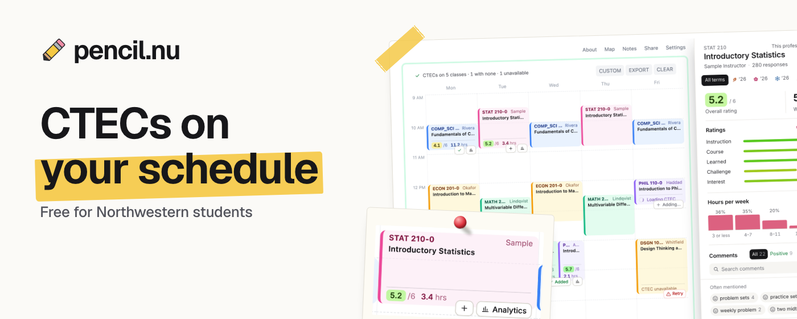

# pencil.nu



pencil.nu is a Northwestern course-planning browser extension for CAESAR and Paper.

## Students: get pencil.nu

Go to [pencil.nu](https://pencil.nu) for the current install link, release notes, and student-facing setup instructions.

This repository is mainly here for transparency and review. If you just want to use pencil.nu, start at [pencil.nu](https://pencil.nu), install the browser extension, then open CAESAR or Paper as usual.

## What pencil.nu adds

- Better CAESAR class search powered by Paper catalog data, with live CAESAR status fetched on demand.
- Seats, notes, requirements, attributes, and section details in CAESAR shopping-cart and class-search views.
- CTEC links and summaries for matching courses and instructors.
- Paper schedule enhancements that show CTEC summaries and analytics alongside schedule cards.
- Enrollment navigation improvements, including term switching and smoother redirects between CAESAR enrollment pages.

## Notes for NUIT

pencil.nu is a client-side browser extension. It does not run a pencil.nu-owned backend that receives student CAESAR data, and it does not add third-party analytics or remote logging in the current codebase.

Sensitive Northwestern session data stays within the browser and Northwestern services:

- CAESAR and CTEC requests are made from the installed browser extension using the student's existing authenticated browser session.
- CAESAR form state, PeopleSoft tokens, cookies, and CTEC page responses are not posted to pencil.nu-owned servers.
- Local extension state is stored in `chrome.storage.local`, `localStorage`, or `sessionStorage` on the device. This includes feature toggles, course/catalog caches, CTEC caches, seat/note caches, rate-limit timestamps, and the local staged-rollout gate data.
- The staged-rollout gate reads the student's CAESAR profile name only to determine rollout eligibility by last-name bucket or local access code. That value is stored locally and is not transmitted to a pencil.nu service.
- Paper catalog data is fetched from Paper data endpoints (`api-legacy.dilanxd.com` and `cdn.dil.sh`) and cached locally. Those requests are for catalog/course data, not CAESAR credentials or CAESAR form submissions.

The requested permissions are scoped to the product surface:

- `storage` and `unlimitedStorage`: local settings and local caches.
- `declarativeNetRequestWithHostAccess`: optional redirect from `caesar.northwestern.edu` to `caesar.ent.northwestern.edu`.
- Host access for CAESAR, Paper, Northwestern SSO, Northwestern Bluera/CTEC, and Paper catalog/CDN endpoints needed by the features above.

Why this should not be problematic for review:

- It is source-available and auditable from this repo.
- It is Manifest V3 and builds to a normal Chrome extension package.
- It augments pages the student already has permission to view.
- It keeps pencil.nu-specific state local to the browser rather than creating a separate student-data store.
- It can be deployed first to a small Google Admin test group or OU before any broad rollout.
- NUIT can disable or force-install it using standard Chrome enterprise app and extension policy controls.

## Build locally

```bash
npm install
npm run typecheck
npm run build
```

Build only Chrome:

```bash
npm run build:chrome
```

Build only Firefox:

```bash
npm run build:firefox
```

Chrome output is written to `dist/chrome`. Firefox output is written to `dist/firefox`.

## Load for local testing

Chrome:

1. Run `npm run build:chrome`.
2. Open `chrome://extensions`.
3. Enable Developer Mode.
4. Click `Load unpacked`.
5. Select `dist/chrome`.

Firefox:

1. Run `npm run build:firefox`.
2. Open `about:debugging#/runtime/this-firefox`.
3. Click `Load Temporary Add-on`.
4. Select `dist/firefox/manifest.json`.

## Shipping a change

Getting work from your machine to students:

1. **Open a PR to `main`.** CI (`.github/workflows/ci.yml`) runs typecheck, lint, tests, and both builds. Keep it green, then merge.
2. **Cut a release.** On `main`, bump `version` in both `src/manifest.base.json` and `package.json`, and prepend a student-facing entry to `src/popup/changelog.json` (the popup's "What's new" panel). Commit that, then tag and push:

   ```bash
   git tag v0.9.15        # must match the manifest version exactly
   git push origin main --tags
   ```

3. **Let the release workflow publish it.** The tag triggers `.github/workflows/release.yml`, which re-runs the checks, verifies the tag matches the manifest version, builds and zips both targets, attaches them to a GitHub Release, and submits them to the [Chrome Web Store](https://chromewebstore.google.com/detail/klgfglapoogiaggfghlbcbfjhhgebahf) and [Firefox Add-ons](https://addons.mozilla.org/en-US/firefox/addon/pencil-nu/).
4. **Wait for store review.** Each store reviews the new version (usually hours to a few days). Once approved, installed copies update themselves; no one needs to reinstall. Track status in the Chrome Web Store Developer Dashboard and the AMO Developer Hub.

If a publish step fails, check the run in the repo's Actions tab. Store credentials live in the repository's Actions secrets:

| Secret | What it is |
| --- | --- |
| `CWS_PUBLISHER_ID` | Chrome Web Store publisher ID |
| `CWS_CLIENT_ID`, `CWS_CLIENT_SECRET` | OAuth client in the `pencil-cws-publish` Google Cloud project (Chrome Web Store API enabled, consent screen in production) |
| `CWS_REFRESH_TOKEN` | Refresh token for that client with the `https://www.googleapis.com/auth/chromewebstore` scope, minted via the [OAuth Playground](https://developers.google.com/oauthplayground) |
| `AMO_JWT_ISSUER`, `AMO_JWT_SECRET` | [AMO API keys](https://addons.mozilla.org/en-US/developers/addon/api/key/) |

If the Chrome token is revoked or a password change invalidates it, mint a new refresh token and update `CWS_REFRESH_TOKEN`. The Firefox build's add-on ID (`pencil@local.dev`, set in `scripts/build.mjs`) must keep matching the AMO listing.

## Bundle and deploy for NUIT

The preferred managed deployment path is Chrome Web Store or private/domain Chrome Web Store distribution, then Google Admin console policy. Google documents enterprise publishing, private domain publishing, allowlisting, and force-install controls in the [Chrome Enterprise publishing options](https://developer.chrome.com/docs/webstore/cws-enterprise/) and [Chrome Admin apps and extensions](https://support.google.com/chrome/a/answer/6177447) docs.

Recommended Chrome Web Store or private-domain flow:

1. Publish a release as described in [Shipping a change](#shipping-a-change); pushing the tag uploads the build to the Chrome Web Store.
2. Choose the appropriate visibility: public, unlisted, trusted testers, or private/domain publishing.
3. After review/publication, provide NUIT the Chrome Web Store extension ID.
4. In Google Admin, go to `Devices > Chrome > Apps & extensions > Users & browsers`.
5. Select the test organizational unit or group first.
6. Add the extension from the Chrome Web Store or by extension ID.
7. Accept the listed permissions on behalf of the organization.
8. Set the installation policy to `Allow install`, `Force install`, or `Force install + pin` depending on the rollout plan.
9. Verify on a managed test device at `chrome://policy`, then broaden the OU/group only after the behavior is confirmed.

Self-hosted CRX flow if NUIT does not want Web Store distribution:

1. Run `npm run build:chrome`.
2. Open `chrome://extensions`, enable Developer Mode, and click `Pack extension`.
3. Use `dist/chrome` as the extension root directory.
4. For the first package, leave the private key field empty. Chrome creates a `.crx` and `.pem`.
5. Store the `.pem` securely. The same key is required for future updates so the extension ID remains stable.
6. Host the `.crx` on HTTPS.
7. Host an update manifest XML file whose `codebase` points to the `.crx` and whose `version` matches `manifest.json`.
8. For every update, increment `src/manifest.base.json`, rebuild, repack with the same `.pem`, update the hosted `.crx`, and update the XML version.
9. In Google Admin, add the extension by ID from a custom URL, using the update manifest URL required by Chrome policy.
10. Test in a small OU/group before force-installing more broadly.

Chrome's package/update documentation covers signed CRX packaging, private keys, update manifests, and update URLs in more detail:

- [Update your Chrome Web Store item](https://developer.chrome.com/docs/webstore/update/)
- [Self-host Chrome extensions](https://developer.chrome.com/docs/extensions/how-to/distribute/host-on-linux)
- [Automatically install apps and extensions](https://support.google.com/chrome/a/answer/6306504)

## Developer architecture

This repo uses one TypeScript WebExtension codebase with browser-specific output:

- `dist/chrome`: Chrome/Chromium Manifest V3 service worker build.
- `dist/firefox`: Firefox-compatible build with background scripts.

Core pieces:

- `src/manifest.base.json`: shared extension manifest, host permissions, and content-script matches.
- `scripts/build.mjs`: esbuild bundle plus browser-specific manifest generation.
- `src/background.ts`: background fetch bridge, auth popup tracking, and CAESAR domain redirect rule.
- `src/content/index.ts`: content-script entrypoint. It starts the access gate, popup messaging, early term mask, and augmentation runner.
- `src/content/framework/*`: reusable augmentation lifecycle and DOM mutation runner.
- `src/content/augmentations/*`: independent feature modules for class search, seats/notes, CTEC links, Paper CTEC UI, and enrollment navigation.
- `src/content/peoplesoft/*`: shared PeopleSoft request orchestration, traffic locking, form-state serialization, and parsing helpers.
- `src/popup/*`: extension popup UI for feature toggles, local cache controls, and access status.
- `src/shared/*`: typed message contracts between content scripts, popup, and background worker.

## Transparency: how pencil.nu works

At page load, Chrome injects pencil.nu's content script only into the page hosts listed under `content_scripts` in `src/manifest.base.json`: CAESAR and Paper. Host permissions separately allow the background worker to fetch required Northwestern SSO/Bluera/CTEC pages and Paper catalog/CDN data.

The content script starts a registry of independent augmentations. Each augmentation decides whether it applies to the current page, finds the relevant DOM nodes, fetches any needed data, and renders a small UI enhancement into the existing CAESAR or Paper page.

For CAESAR pages, pencil.nu reads the current PeopleSoft form state from the active page and sends normal CAESAR requests with the same authenticated browser session the student is already using. It parses the returned HTML locally and renders class status, seats, notes, enrollment metadata, or CTEC links.

For Paper pages, pencil.nu uses Paper catalog data for course search and schedule context. When CTEC data is requested, the extension uses the student's Northwestern session to read the relevant Northwestern CTEC/Bluera pages, parses summaries locally, and stores only local cache entries in the browser.

The background worker does not maintain a server-side data store. It only handles extension tasks that need background privileges: cross-origin fetches allowed by the manifest, opening/closing the Northwestern auth popup, and maintaining the optional CAESAR short-domain redirect rule.

Local caches exist to reduce repeat CAESAR/CTEC/Paper requests and to keep the UI fast. Students or admins can clear extension storage through Chrome extension settings or browser storage controls.

## License

pencil.nu is released under the MIT License. See [LICENSE](LICENSE).
